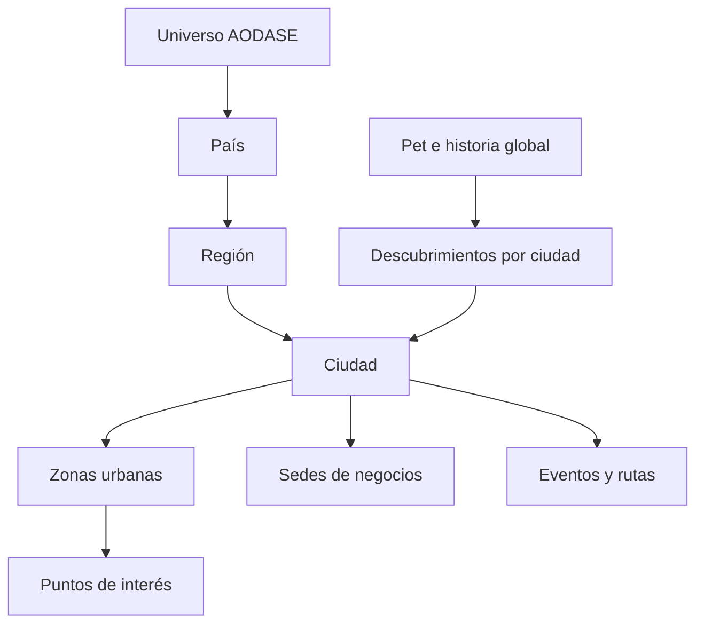

# AODASE PETS — Game Design Document técnico

**Versión 2.2 · 6 de octubre de 2026 · Ciudad piloto: Villavicencio, Meta, Colombia.**

Documento vigente de producto. Fuente: los 60 apartados del «Plan Maestro del videojuego y ecosistema urbano» aportado por el creador. Reemplaza las decisiones de marca, alcance comercial e ingreso del GDD de Foodie Pets. Conserva sus reglas útiles de persistencia, cuidados, combate y protección de colecciones; los documentos anteriores quedan como historia de implementación.

## 1. Promesa del universo

**Tu ciudad. Tu Pet. Tu evolución.** El mundo real será el mapa; los negocios y espacios públicos serán lugares del videojuego; la criatura será el vínculo emocional. Una visita, un descubrimiento o una decisión de ADN podrá formar parte permanente de su historia.

AODASE empieza con densidad de contenido en Villavicencio. La arquitectura permite incorporar otras ciudades sin convertir la primera versión en una simulación mundial ni construir todos los edificios en 3D.

El progreso central es gratuito. Cuidar, conseguir criaturas, obtener ADN básico, evolucionar y explorar no dependerán de comprar. El comercio aporta opciones, experiencias y colección dentro del universo.

## 2. Cambios frente a Foodie Pets

| Decisión | Regla vigente |
|---|---|
| Marca y PWA | AODASE PETS |
| Mercado | Negocios locales de cualquier categoría, más lugares públicos |
| Primera ciudad | Villavicencio, identificada internamente como `CO-MET-VVC` |
| Inicio de una cuenta nueva | Registro → incubadora → huevo → nacimiento → nombre |
| Mascotas existentes | Conservan ID, apariencia, estadísticas, progreso y genoma |
| Editor, Random, dados y dardo | Taller experimental conservado; no genera el primer Pet del nuevo recorrido |
| Mundo 3D actual | Campo PvE separado del futuro mapa geográfico |
| Landing | Identidad tecnológica y animada; escenas conceptuales claramente identificadas |
| Negocios de prueba | Demostración visible; no se presentan como aliados confirmados |

No renombrar tablas, tokens de almacenamiento ni IDs solo para cambiar la marca. Esas operaciones romperían sesiones, facturas y referencias sin aportar jugabilidad. Los nombres internos `foodie_*` y los IDs antiguos se mantienen por compatibilidad.

## 3. Qué hay disponible y qué sigue en diseño

La base dispone de cuenta, colección, cuidados, incubación, nacimiento, catálogo genético inicial, misiones de bienvenida, PvE 3D y canje de facturas. Esta adaptación incorpora el inicio con huevo, nombre persistente del Pet, categorías generales de negocio, identidad urbana y metadatos territoriales.

**Todavía no están implementados:** mapa geográfico conectado, posición del jugador, visitas físicas verificadas, misiones urbanas, obtención y consumo de ADN, primera transformación evolutiva, ledger empresarial, portal propio por negocio ni actividad social compartida. La presencia de una ciudad o un nombre de fantasía en un registro no activa esos sistemas.

La guía [IMPLEMENTACION-AODASE.md](IMPLEMENTACION-AODASE.md) registra el estado comprobado de cada entrega.

## 4. Ciclos principales

**Vínculo:** observar necesidades → cuidar → percibir una reacción → recuperar bienestar → incubar o entrenar → regresar.

**Exploración urbana:** abrir mapa → elegir una oportunidad → desplazarse voluntariamente → descubrir → completar actividad gratuita → conseguir recurso o ADN → decidir una adaptación → observar el cambio → encontrar un nuevo objetivo.

**Comercial:** negocio autorizado configura contenido → jugador descubre el lugar → visita e interactúa → compra opcional → validación → entrega única → origen conservado en la historia del Pet.

Cada ciclo debe funcionar sin exigir que el usuario comparta su posición continuamente ni encuentre una compra disponible. El campo PvE y los cuidados siguen ofreciendo actividad mientras se construye el mapa.

## 5. Entrada, huevo y nacimiento

La portada lleva a crear cuenta o iniciar sesión. Una cuenta sin colección entra en la incubadora; una cuenta con mascotas conserva su acceso a la colección y al hábitat. Un diseño pendiente del taller no sustituye el huevo de una cuenta nueva.

El huevo contiene identidad, genoma privado, pistas públicas, temática, origen, fecha de creación, `readyAt`, interacciones y vínculo al Pet nacido. Estados: `incubating → ready → hatched`. El servidor decide el resultado y el instante de maduración.

**Balance vigente (7 de octubre):** un huevo de bienvenida por cuenta y 90 segundos de incubación por defecto. Nace al vencer el reloj o al recibir el tercer Dar calor, lo que ocurra primero. Cada cuidado confirmado suma +1 a todas las estadísticas base, hasta +3; sin calor el bebé nace con las estadísticas originales más bajas. El calor tiene tres segundos de espera entre acciones. La cáscara muestra grietas progresivas con una animación cada 20 segundos y con cada cuidado. Tras confirmar el nacimiento se rompe por completo durante dos segundos y revela al bebé. El servidor decide tiempo, cuidados y bonus; no acepta cifras del cliente. La configuración admite de 90 segundos a siete días para huevos nuevos, conservando las fechas ya guardadas.

Primer nacimiento: crear colección si estaba vacía, añadir el Pet, seleccionarlo y confirmar genoma, misión, perfil y recibo en una transacción. Para un Guardián existente, el huevo añade un compañero sin cambiar su selección activa.

Después del nacimiento se ofrece nombre de 1–24 caracteres de texto. Renombrar altera únicamente `name`; no crea otra identidad ni modifica genes, estadísticas, selección o etapa. Validar propiedad, texto e idempotencia en servidor.

## 6. Mascota viva y regreso

Necesidades actuales: saciedad, energía, ánimo, salud, afecto, higiene y curiosidad. Sueño, estrés, condición física y socialización serán dimensiones adicionales cuando tengan acciones y comportamiento asociados. La salud del hábitat es distinta de la vida de combate.

La ausencia genera deterioro acotado y una recuperación gratuita. Ningún Pet muere permanentemente ni pierde meses de progreso. El cálculo usa el reloj del servidor, conserva fracciones de tiempo y limita el desgaste acumulado por visita. La interfaz debe expresar necesidad mediante postura, actividad y respuesta visual, además de barras.

El hábitat ya ofrece respiración, parpadeo, atención, movimiento de orejas y cola, y seis reacciones 3D de entre tres y cuatro segundos: alimento y bocados, pelota, sueño, burbujas, corazones y entrenamiento. Una intención tiene anticipación; el resultado exitoso procede de la respuesta del servidor. Un fallo cancela la reacción sin mostrar una recompensa ficticia. Cuidar y renombrar conservan el mismo lienzo WebGL. La vista pausa al ocultarse y respeta movimiento reducido.

El primer sistema conserva personalidad «curioso». La ampliación incorporará curioso, valiente, tranquilo, travieso, glotón, tímido, competitivo, cariñoso y explorador con efectos suaves y sin bloquear rutas de progreso.

## 7. Genética, identidad y linaje

```text
Pet(pet_id, owner_id, genome_id, birth_date, origin, generation)
Genome(genome_id, rules_version, loci, recessive_alleles, mutations)
Phenotype(species, shape, dimensions, colors, eyes, appendages, markings)
Lineage(parent_ids, generation, breeding_event_id)
EvolutionHistory(stage, adaptation_id, source_grant_ids, previous_form, at)
```

Identidad única no exige blockchain. Un fingerprint describe una combinación genética; no demuestra que dos fenotipos sean diferentes ni reemplaza el ID único del Pet. Los alelos ocultos no se envían al cliente. El catálogo recibe rasgos conocidos, pistas y un contador de información no investigada.

El catálogo de nacimiento contiene 14 familias: gato, insecto, extraterrestre, monstruo, dragón, espíritu, perro, conejo, zorro, oso, ave, ajolote, tortuga y pez. Las afinidades cambian sus probabilidades sin excluir familias. Los cruces anatómicos combinan piezas compatibles manteniendo la cabeza, ojos y apéndices unidos. El genoma registra especies, humor visual, nueve pelajes, seis marcas, seis colores de iris, orejas, alas, cola, ojos, extremidades, dimensiones, geometría, paleta y afinidad. Sus alelos expresados coinciden con el fenotipo almacenado; los recesivos permanecen privados.

La dirección artística conserva 3D y adopta proporciones de mascota coleccionable: ojos grandes, hocico pequeño, siluetas redondeadas, vientre contrastante, tonos suaves y contornos discretos. Los modelos y patrones son originales y procedurales. El taller conserva sus herramientas de edición y escultura. El [documento de arte y vida](ARTE-GENETICA-Y-VIDA.md) detalla el renderer y sus contratos.

Los fundadores importados y los huevos sin padres son generación 0. No inventar genealogía para una mascota existente. La reproducción futura requiere compatibilidad, costes gratuitos equilibrados, cruces de alelos, mutación acotada, versión de reglas y una operación única por huevo.

## 8. ADN y primera evolución

La elección evolutiva ofrecerá exactamente tres opciones elegibles. Primera propuesta: **Titán**, **Veloz** y **Arcano**. Los fragmentos obtenidos pueden sustituir una opción por una adaptación autorizada, por ejemplo Naturaleza; el menú siempre conserva tres alternativas y explica coste, cambio visual y efecto.

Reglas de la primera evolución, todavía por implementar:

1. Servidor comprueba etapa, requisitos de cuidado/entrenamiento y fuentes de ADN.
2. Emite una oferta versionada con tres opciones y sus costes.
3. Jugador elige una; no puede enviar un bono inventado.
4. Una transacción consume fragmentos, aplica adaptación y registra su origen.
5. Devuelve el nuevo fenotipo y el historial; reintentos no vuelven a consumir.

| Adaptación | Cambio legible | Efecto orientativo |
|---|---|---|
| Titán | Cuerpo robusto, patas fuertes, postura baja | Resistencia y fuerza; menor movilidad |
| Veloz | Silueta ligera, extremidades ágiles | Movimiento y reflejos; menor resistencia |
| Arcano | Marcas, brillo y estructuras especiales | Energía y habilidades; mayor consumo |

Las cifras de bonos quedan pendientes de balance. La evolución no debe ser únicamente un aumento numérico. Preservar cabeza coherente, ojos unidos y piezas conectadas mediante el sistema de modelo actual. Guardar los cambios aplicados para que una futura actualización de catálogo no transforme silenciosamente Pets existentes.

## 9. Arquitectura territorial



El piloto usa país `CO`, región `CO-MET`, ciudad interna `CO-MET-VVC` y zona horaria `America/Bogota`. El ID de ciudad es un identificador del producto, no un código municipal oficial. Los Pets y cuentas son globales; misiones, oportunidades, horarios y descubrimientos tienen alcance territorial explícito.

No usar `currentZone` del RPG para una ubicación real. `aldea`, `bosque` o `ruinas` pertenecen al campo 3D y deben convivir con un futuro `active_city_id` y los IDs de zonas urbanas.

## 10. Modelo urbano objetivo

```text
Country(id, name)
Region(id, country_id, name)
City(id, region_id, name, timezone, bounds, status, content_version)
UrbanZone(id, city_id, name, biome_tag, geometry, access_rules)
POI(id, city_id, zone_id, kind, title, location, source, review_status)
Business(id, owner_organization_id, real_name, category, status)
Branch(id, business_id, city_id, poi_id, address, coordinates, schedule)
GamePlace(id, poi_id, fantasy_name, affinity_id, level, enabled_roles)
Opportunity(id, place_id, definition_id, start_at, end_at, limits)
```

Negocio y sede serán entidades distintas: una empresa puede tener varias sedes y una ubicación debe pertenecer a una sola ciudad activa. La tabla `stores` actual representa provisionalmente una sede, conservando sus referencias de productos y facturas.

Los parques y monumentos serán POIs públicos; no convertirlos en empresas ficticias para reutilizar la tabla de comercios. Un rol —arena, laboratorio, misión, tienda virtual o minijuego— exige contenido y un servicio funcional antes de mostrarse como disponible.

## 11. Catálogo de negocios de esta entrega

Categorías compartidas: restaurantes, comida rápida, postres, panaderías, cafeterías, tiendas, moda, gimnasios, entretenimiento, servicios, tecnología, centros comerciales y otros negocios. Conservar los IDs de categorías anteriores para que las facturas existentes sigan funcionando.

Metadatos nuevos de `stores`: `city_id`, `country_code`, `region_id`, `game_name`, `affinity`, `place_roles`, `location_known`, `is_demo`. Migración aditiva sin reconstruir la tabla ni romper claves externas.

`location_known` significa que se cargaron coordenadas válidas, **no que la ubicación o una visita estén verificadas**. Ubicación desconocida se expone como `lat: null, lng: null`; no mostrar distancia inventada ni un marcador en 0,0. El almacenamiento heredado conserva sus columnas originales.

La lista inicia en Villavicencio, permite buscar y filtrar por categoría y conserva acceso a otras ciudades presentes en registros antiguos. Si no hay negocios cargados, se muestra ese estado real. Los registros de demostración se identifican con su etiqueta y no cuentan como cobertura del piloto.

## 12. Mapa real y posición del jugador

Siguiente entrega: mapa 2D real con zoom, capas de zonas, POIs, negocios y oportunidades publicadas. Seleccionar proveedor y datos cartográficos con atribución y condiciones de uso comprobadas antes de incorporarlos; mantener un adaptador para no ligar la economía a un proveedor.

Permiso de ubicación solicitado cuando el usuario decide localizarse. Sin permiso se puede navegar el mapa, consultar contenido y jugar actividades del hábitat o campo 3D. No presentar navegación virtual como visita física.

La posición debe contener timestamp y precisión. Aplicar caducidad, comprobar rangos y descartar saltos imposibles antes de evaluar proximidad. Un radio aislado o una coordenada enviada por el cliente no prueban asistencia. No se necesita guardar una trayectoria permanente para mostrar contenido cercano.

El mapa distingue: publicado/activo, próximo, desconocido, visitado y temporalmente no disponible. Desconocido no significa inaccesible: una pista explica cómo descubrirlo. No colocar recompensas en zonas peligrosas o inaccesibles; cada lugar requiere revisión de acceso y disponibilidad.

## 13. Descubrimiento y visita

Separar tres operaciones:

| Operación | Qué acredita | Premio posible |
|---|---|---|
| Consultar | Leer una ficha del mapa | Sin premio de visita |
| Descubrir | Primera interacción verificable con un lugar autorizado | Premio gratuito pequeño y único |
| Comprar | Factura o transacción validada | Recompensa comercial presupuestada |

Para el piloto de visitas, combinar proximidad suficientemente precisa con una actividad o desafío del lugar y mecanismos de validación adecuados al premio. Ofrecer una ruta virtual alternativa con premios propios cuando no sea posible desplazarse; nunca falsificar el origen de una visita real.

Registro objetivo: `Visit(id, guardian_id, place_id, validation_method, timestamp, accuracy_band, status)`. Descubrimiento único por `(guardian_id, place_id, content_version)`. Mantener el mínimo de datos necesario; no mostrar a otros jugadores coordenadas exactas ni teléfono.

## 14. Misiones, rutas y minijuegos

Definiciones por datos: personales, exploración, ciudad, negocios, evento, sociales y linaje. Una misión establece alcance, pasos, eventos que cuentan, límites, recompensa y versión. El servidor recibe eventos validados, no porcentajes enviados por el cliente.

Una ruta conecta varios lugares y puede incluir comercios de distintas categorías y POIs gratuitos. Verificar continuidad, duración razonable y horarios antes de publicar. Un negocio cerrado no debe bloquear indefinidamente una ruta; definir pausa o sustitución autorizada.

Primeras actividades propuestas: reconocer un punto público, completar tres descubrimientos y un minijuego breve en un establecimiento. El minijuego debe guardar intento, duración, resultado validado y premio único o acotado. No añadir botones de minijuegos sin una actividad disponible.

## 15. Contenido comercial autorizado

Un establecimiento puede ofrecer contenido del catálogo controlado por AODASE: monedas, XP, alimentos, fragmentos de ADN, gemas, objetos, cosméticos, huevos o progreso de misión. El comerciante elige posibilidades autorizadas; no escribe estadísticas ni crea ADN arbitrario.

```text
RewardDefinition(id, version, type, payload, rarity, eligibility, max_per_guardian)
Campaign(id, organization_id, branch_id, city_id, schedule, budget, reward_definitions)
RewardGrant(id, definition_id, guardian_id, campaign_id, source_id, claimed_at)
```

El origen acompaña al premio: sede, ciudad, evento, campaña y fecha. Una evolución puede referenciar los grants de ADN que utilizó para que la visita contribuya a la historia genética.

Los ejemplos del plan de 35.000 Coins o 500 XP expresan una experiencia deseada; no fijan balance, equivalencia COP/Coins ni valor monetario final.

## 16. Economía y ledger empresarial

La base mantiene `profile.world.coins` para aventura y `profile.currency` para las recompensas heredadas. Esta adaptación no fusiona esos saldos ni anuncia venta de paquetes Coins ya disponible.

El futuro ledger distingue fondos empresariales, saldo distribuible y monedas de jugadores. Cada movimiento tendrá asiento, fuente, idempotency key y reversión compensatoria. Reservar presupuesto al activar una campaña y liquidarlo al entregar un premio; impedir saldos negativos y conciliación doble.

Para una compra: comprobar sede y permisos → comprobar referencia única de factura → validar presupuesto → emitir grants → actualizar saldo y progreso → consumir el código → confirmar historial, todo en una transacción. Una factura que falla no debe consumir presupuesto ni entregar parcialmente.

Las gemas son objetos con efectos y slots, no otra moneda por defecto. Los artefactos, ropa y armaduras comparten inventario por definiciones; distinguir cosmético de efecto funcional. Evitar inventar una moneda para cada tipo de recompensa.

## 17. Competición, eventos y social

Cooperación y encuentros preceden al PvP avanzado. Para competir, normalizar estadísticas o usar presupuestos de poder y categorías; comprar no garantiza vencer. Mantener autoridad de servidor sobre combate y resultados antes de ligar torneos a premios comerciales.

Eventos: alcance por ciudad, ventana horaria del lugar, definiciones versionadas, presupuesto, controles de publicación y estado de cierre. No mostrar usuarios o eventos ficticios como actividad real.

Perfiles públicos optativos y presencia agregada por zona. No mostrar el desplazamiento continuo de personas. Crianza, intercambio y marketplace pertenecen a fases posteriores con requisitos propios de propiedad, fraude y balance.

## 18. Portal empresarial

El administrador actual puede cargar negocios de distintas categorías y su ubicación declarada. **Todavía no es un portal de autoservicio empresarial.**

Modelo futuro: organización, miembros con roles, sedes autorizadas y permisos para campañas, presupuesto, emisión de facturas y lectura de métricas. Un administrador de una sede no puede editar otra por conocer su ID. El jugador no recibe datos personales de clientes ni secretos de campaña.

El portal debe incluir aprobación del negocio, actividad publicada y conciliación; no basta con un formulario de registro para declarar alianza activa. Las métricas usan datos agregados de visitas y canjes, con acceso por organización.

## 19. Arquitectura de software

Mantener un monolito modular sobre TypeScript/Three.js/Vite y Express/SQLite. Dominios: Guardian, Genome, Evolution, Territory, Discovery, Quest, Commerce, Ledger y Presence. Dominios con reglas puras, reloj/RNG inyectados y DTOs públicos explícitos.

Las tablas nuevas de hábitat y recibos siguen siendo compatibles. Ampliar territorio con tablas separadas cuando llegue el mapa; no reescribir el JSON de cada Pet para modificar una ciudad.

En el piloto, la transacción SQLite es la frontera de consistencia. Migrar tecnología por carga y concurrencia medidas, no por la expectativa de expansión mundial. El servidor de combate actual conserva autoridad parcial; no permite declarar un PvP seguro.

## 20. Contratos actuales y futuros

| Ruta actual | Función |
|---|---|
| `GET /api/guardian` | Perfil, colección vacía o poblada, cuidados y huevos |
| `POST /api/guardian/action` | Intención con `requestId`; incluye `rename_pet` con `petId` y `name` |
| `GET /api/urban/catalog` | Categorías, ciudades y ciudad piloto por defecto |
| `GET /api/cities` | Ciudades habilitadas |
| `GET /api/stores` | Negocios con metadatos normalizados |
| `GET /api/stores/:id` | Ficha y contenido comercial existente |
| `POST /api/admin/stores` | Crear sede declarada, con autenticación de administrador |
| `PATCH /api/admin/stores/:id` | Modificar metadata sin cambiar su ID |

Rutas objetivo, **aún no disponibles**: consulta territorial por viewport, inicio/confirmación de descubrimiento, misiones urbanas, oferta de evolución, elección de adaptación, configuración empresarial de campañas y movimientos de ledger.

No aceptar del cliente saldo resultante, fecha de incubación, genotipo, premio de visita, nivel evolutivo ni experiencia ganada. Repetir una intención no repite sus efectos; reutilizar su ID con otro contenido produce conflicto.

## 21. Arte, rendimiento y accesibilidad

Portada: noche urbana, luz cálida y holográfica, criaturas orgánicas y geometría tecnológica. El esquema de ciudad ilustra la visión; el mapa real es una pantalla distinta con datos cartográficos verificables.

El hábitat conserva su ambiente cálido y legible. El campo 3D conserva la mejora de luz, vegetación y contacto con el suelo. Identidad llanera en futuras criaturas, biomas y narrativa debe tener diseño propio y assets con procedencia definida.

Movimiento reducido, foco visible, alternativas al gesto, contraste y controles táctiles grandes. Cuidado y catálogo admiten ambas orientaciones; acción 3D utiliza horizontal. Medir 30 FPS móvil y 60 FPS escritorio como objetivos, sin presentarlos como resultados de pruebas en hardware que no se hicieron.

## 22. Secuencia de entregas

| Bloque | Alcance | Criterio de salida |
|---|---|---|
| A0 — adaptación actual | Marca, landing, huevo primero, nombre, negocios genéricos y territorio básico | Recorrido nuevo y legado probado; sin pérdidas |
| A1 — primera evolución | Tres ADN, oferta canónica, costes, cambio visual, historial | Elegir una adaptación y ver su efecto persistente una sola vez |
| A2 — mapa Villavicencio | Mapa real, posición opcional, POIs revisados y capas | Consultar oportunidades verdaderas sin inventar aliados |
| A3 — primera ruta gratuita | Descubrimiento validado, minijuego, misión y ADN | Completar ruta sin compra y usar ADN en evolución |
| A4 — comercio completo | Organización/sedes, campañas, Reward Definitions y ledger | Compra real con presupuesto, grants y conciliación transaccional |
| A5 — piloto vivo | Contenido llanero, catálogo, eventos y métricas reales | Densidad útil y retención comprobadas en Villavicencio |
| A6 — social y expansión | Perfiles optativos, cooperación; siguiente ciudad | Replicar datos y contenido conservando historias globales |

Conservar el orden conceptual de fases 0–10 del plan maestro: identidad, Pet, evolución, mundo, negocios, recompensas, misiones, social, Villavicencio vivo, Colombia e internacional. Los bloques agrupan entregas técnicas comprobables; no declaran completadas las fases posteriores.

## 23. MVP urbano completo

El MVP queda demostrado cuando una persona puede: crear cuenta → recibir huevo → cuidarlo → nacer y nombrar Pet → mantenerlo → explorar el mapa real → descubrir lugar autorizado → completar misión gratuita → recibir ADN → elegir una de tres adaptaciones → ver cambiar la criatura y consultar el origen.

La entrega A0 todavía no completa ese recorrido urbano. Completa la adaptación de identidad y base, con el ciclo de huevo/cuidado persistente y catálogo empresarial. Los hitos A1–A4 deben producir el recorrido entero antes de promocionar un lanzamiento urbano completo.

## 24. Validación y criterios de calidad

- Inicio con cuenta vacía sin generar automáticamente un personaje del taller.
- Primer nacimiento único y seleccionado; nacimiento adicional conserva selección y fundador.
- Nombre validado y persistente; los reintentos no reescriben otras propiedades.
- Genotipo privado y aparición coherente de la criatura.
- Migración de negocios preserva IDs, productos, promociones y facturas.
- Categorías generales, filtros, ciudad piloto y resultados vacíos reales.
- Coordenadas desconocidas nulas en DTO; datos demo identificados.
- Coordenadas válidas no otorgan por sí solas visitas ni premios.
- Campo 3D y futuro mapa real claramente separados.
- Recursos de UI y vistas 3D liberados al salir.

En el piloto medir embudo de huevo, cuidado, descubrimiento, evolución, retorno, variedad de contenido por zona, fricción de permisos, premios por fuente y errores. No activar analítica externa ni recopilar ubicación continua sin una decisión de producto y permisos adecuados.

## 25. Trazabilidad de los 60 apartados

| Apartados | Implementación o sistema objetivo |
|---|---|
| 1–2, 19–24, 48–50, 59–60 | Universo urbano, densidad local, territorio y expansión |
| 3–9 | Inicio con huevo, pistas privadas, incubación y nacimiento |
| 10–13 | Necesidades, ausencia recuperable, comportamiento y personalidad |
| 14–18 | ADN, cambios visibles, elecciones y fuentes del mundo |
| 25–28, 33 | Negocios como lugares, descubrimientos, premios y minijuegos |
| 29–32 | Gemas como objetos, vestimenta, armaduras y artefactos |
| 34–37 | Misiones, rutas, eventos y torneos |
| 38–42 | Social, enciclopedia, linajes, reproducción e identidad sin NFT |
| 43–47 | Acceso gratuito, no pay-to-win, economía, portal y control del catálogo |
| 51–54 | Vertical completa, MVP, límites y roadmap |
| 55–58 | Ciclos, emoción y trazabilidad del origen en la evolución |

## 26. Decisiones pendientes para el piloto

Proveedores y fuentes del mapa; inventario real de negocios y POIs; validación presencial según valor del premio; condiciones y presupuesto de campañas; duración final de incubación; catálogo y balance del primer ADN; reglas de evolución; dispositivos de referencia y equipo de contenido.

Estas decisiones no bloquean la adaptación actual. Sí son necesarias antes de desplegar visitas premiadas, ventas de Coins, campañas públicas o un lanzamiento que afirme que Villavicencio ya es un mundo urbano operativo.
