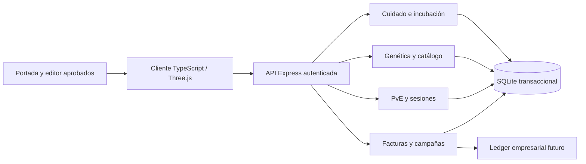

# Foodie Pets — Game Design Document técnico

> Documento histórico. Desde el 6 de octubre de 2026, el [GDD de AODASE PETS](GDD-TECNICO-AODASE-PETS.md) reemplaza marca, alcance comercial e inicio del jugador, conservando los sistemas compatibles descritos aquí.

**Versión:** 1.0 · **Fecha:** 5 de octubre de 2026 · **Estado:** diseño de producción y primera implementación del ciclo de crianza.

**Fuente de producto:** «Foodie Pets — Concepto integral del videojuego», 57 apartados aportados por el creador del proyecto. Este documento convierte esa visión en sistemas, contratos, reglas y entregas comprobables. Los valores de balance son hipótesis iniciales; los ejemplos de miles de Coins del concepto no constituyen precios ni recompensas definitivas.

## 1. Visión y promesa

Foodie Pets es un juego de crianza, exploración y colección de criaturas únicas en el que los restaurantes y otros lugares reales aportan descubrimientos y aventuras. El jugador es un **Guardián**: cuida, entrena y acompaña criaturas; descubre sus genes y construye una historia y un linaje.

La unidad de diversión es **la criatura y su historia**. El programa comercial aporta contenido al universo, pero el juego completo debe tener una ruta de progreso gratuita. Comprar comida nunca garantiza ganar un combate ni es condición para cuidar, explorar o participar en el ciclo principal.

### Pilares verificables

1. **Vínculo:** las acciones producen una reacción visible de la mascota y un cambio persistente.
2. **Descubrimiento:** huevos, variantes, genes, biomas y evolución revelan información gradualmente.
3. **Decisión:** alimentación, entrenamiento, equipo y afinidades ofrecen elecciones con ventajas y costes.
4. **Acceso gratuito:** todo sistema central dispone de actividades y recursos obtenibles jugando.
5. **Unicidad verificable:** identidad, origen, genoma y genealogía pertenecen al servidor; no requieren blockchain.
6. **Mundo compartido respetuoso:** cooperación y presencia social sin publicar la posición exacta de las personas.
7. **Continuidad:** conservar la portada, el editor aprobado, los personajes existentes y los códigos de factura ya emitidos.

## 2. Límites de producto y plataformas

Aplicación web instalable sobre el proyecto actual: TypeScript, Three.js y Vite; servidor Express y SQLite. Cuidado, catálogo, comercio e incubación admiten orientación vertical y horizontal. El mundo de acción utiliza horizontal, flechas y joystick, Q/W/E/R, ataque básico y consumibles rápidos.

El objetivo gráfico es **fantasía estilizada con materiales e iluminación creíbles**. No se sustituye la personalidad de las mascotas por animales fotorrealistas. Primero mejorar iluminación, contacto con el suelo, vegetación, lectura del combate y animaciones; después introducir assets artísticos por bioma cuando exista presupuesto de rendimiento medido.

La primera versión sigue siendo individual con persistencia. Mostrar un contador de Guardianes, grupos o combates compartidos exige presencia real y un servidor de partidas; no se simulará actividad social como si fueran usuarios reales.

## 3. Auditoría de la base actual

| Área | Ya existe | Consecuencia para el desarrollo |
|---|---|---|
| Portada | Marca Foodie Pets, mascotas 3D, recorrido comercial y espacio de QR | Se conserva |
| Creación | Editor avanzado, Random híbrido, dados y dardo animados | Se conserva; sirve como elección visual del compañero fundador |
| Colección | Identidad FP, nivel, XP, selección y guardado | Reutilizar sin sustituir Pets existentes |
| Mundo | Cinco zonas, enemigo de prueba, combate, joystick, QWER | Base del PvE; necesita balance y autoridad completa del servidor |
| Objetos | Pociones, maná, armas, armadura y reliquias | Extender catálogo por datos; conservar accesos rápidos y ausencia de fabricación |
| Comercio | Negocios, productos, códigos QR, historial y XP | Conservar validación de factura y consumo único |
| Persistencia | Perfil JSON, revisión, transacciones SQLite | Separar nuevos agregados y migraciones versionadas |
| Genética y cuidado | No formaban parte del ciclo jugable | Primera ampliación de esta entrega |
| Geolocalización, cooperación, crianza y territorios | No implementados | Entregas posteriores con requisitos propios |

**Deuda crítica:** la autoridad actual del combate es parcial: el servidor calcula premios, daño y recargas, pero posición, vida del jugador y parte de las habilidades se simulan localmente. Antes de competición o recompensas comerciales de alto valor se necesita simulación autoritativa y pruebas de fraude. La existencia de un endpoint de premios no convierte por sí sola el mundo en un servidor multijugador seguro.

## 4. Ciclos de juego

### Sesión corta, 3–8 minutos

Entrar al hábitat → observar estado → alimentar/jugar/asear → atender un huevo → elegir una misión → reclamar una recompensa o explorar. El resultado debe sentirse útil aun sin desplazarse ni realizar una compra.

### Sesión de aventura, 10–25 minutos

Preparar Pet y consumibles → elegir bioma → combatir y resolver objetivos → descubrir ADN/objetos → regresar al hábitat → investigar o entrenar → progresar hacia una evolución.

### Meta de semanas

Huevo → cría → juvenil → adulta → especialización → evolución → reproducción → linaje → grupo → hábitat → comunidad y temporadas.

### Ciclo comercial

Negocio configura una campaña autorizada y con presupuesto → jugador descubre el contenido → visita o compra opcionalmente → servidor valida interacción → entrega única de recompensa → la criatura obtiene una nueva historia → jugador continúa jugando.

## 5. Transición desde el editor aprobado

El editor y el inicio actuales tienen aceptación explícita del creador y no se reemplazan en esta entrega. Los Pets existentes se registran como **fundadores de generación 0**. El hábitat ofrece un huevo inicial adicional como primer descubrimiento de crianza.

Una versión futura puede presentar primero la elección del huevo y utilizar el editor para orientar el fenotipo o personalizarlo al nacer. Eso requiere una decisión de producto independiente: no debe borrar diseños, resultados de dados, regalos ni colecciones existentes. Los ajustes cosméticos posteriores no deben reescribir los alelos heredables sin una operación genética explícita.

## 6. Incubación y nacimiento

### Máquina de estados

`elección disponible → incubando → listo → nacido`.

Un huevo tiene identidad, temática, origen, fecha de creación, maduración, interacciones y vínculo al Pet nacido. El servidor determina las fechas y el resultado. El cliente muestra pistas —afinidad, hábitat y familia probable— pero no revela toda la genética ni una rareza garantizada.

**Primer ciclo de desarrollo:** Bosque, Fuego, Agua o Misterioso; un huevo gratuito por cuenta, tres cuidados y maduración de 30 segundos. Cada cuidado tiene una espera mínima de tres segundos. Estos tiempos facilitan probar el recorrido; **no representan los tres días de incubación de la visión final**.

**Balance futuro:** primer huevo, 2–5 minutos activos; huevos de colección, 4–24 horas con progreso pasivo y aceleradores gratuitos; huevos de evento, configuración limitada por el catálogo. Se evita exigir regresar en una hora exacta.

### Nacimiento

Al nacer se realiza una única transacción: comprobar dueño y estado → generar identidad y genoma → crear Pet → registrar descubrimiento → actualizar misión → marcar huevo nacido. Reintentar devuelve el mismo nacimiento; nunca produce una segunda criatura. La animación se reproduce después de confirmar el resultado y admite movimiento reducido.

## 7. Identidad y genética

### Modelo objetivo

```text
PetIdentity
  petId, guardianId, genomeId, geneticFingerprint
  origin, bornAt, generation, parents[], lineageVersion

Genome
  schemaVersion, loci[], mutations[], seedCommitment
  locus = { key, alleles:[a,b], dominanceRule, expressionRule }

Phenotype
  speciesFamily, bodyType, headShape, limbCount, proportions
  primaryColor, secondaryColor, accentColor, eyes, coat
  ears, wings, tail, antennae, spikes, sculpture
```

`petId` y `genomeId` son UUID distintos. La base de datos impide duplicar identidades. La huella genética permite comparar genotipos; **no debe prometer que nunca existirán genomas iguales**, especialmente entre hermanos o variantes comunes. Dos mascotas pueden tener el mismo fenotipo y diferentes alelos ocultos. Si se exige exclusividad de un genoma de evento, usar una restricción única específica y regeneración limitada dentro de la transacción.

### Genotipo y fenotipo

Cada locus posee dos alelos. El fenotipo se calcula con reglas versionadas, no por orden alfabético ni por elección del cliente. Los genes no investigados quedan fuera del DTO público: enviar `hiddenGenes` como contador y mostrar `???`; no enviar alelos secretos escondidos en HTML o JavaScript.

El fundador hereda su aspecto aprobado como fenotipo inicial y recibe genética generada en el servidor. En el primer incremento se almacena un genoma básico y se muestran identidad, origen, afinidad, generación y genes conocidos. El laboratorio, los catalizadores y las mutaciones activas pertenecen a la entrega de crianza.

### Dirección visual de híbridos

Se permiten familias mezcladas, ojos de insecto, manos, tentáculos, alas, cuerpos estrechos/anchos/altos y paletas intensas. La cabeza conserva una posición coherente y los ojos se apoyan sobre su superficie. Extremidades, alas y cola nacen dentro del volumen del torso. La escultura de la cara tiene límites más suaves que la del cuerpo. Todos estos rasgos se guardan y deben reproducirse en editor, colección, hábitat y combate.

## 8. ADN, investigación y crianza

El ADN es un recurso de descubrimiento, no una moneda intercambiable por dinero. Fuentes gratuitas: PvE, exploración, misiones, logros y expediciones. Los negocios pueden aportar variantes temáticas dentro de un catálogo permitido y con presupuesto.

### Reglas de reproducción propuestas

- Ambos padres pertenecen al Guardián o existe un permiso explícito para criar; nunca modificar otra cuenta con una solicitud del cliente.
- Etapa adulta, energía suficiente, compatibilidad y recarga de crianza.
- Por locus, seleccionar un alelo de cada progenitor; aplicar mutación según una tabla versionada y topada.
- Generación de la cría: `max(generación de padres) + 1`.
- Prohibir padre con su descendiente directo en el formato competitivo; definir por datos el resto de restricciones de parentesco.
- Consumir recursos y crear huevo en una transacción idempotente.
- Mostrar probabilidades autorizadas e incertidumbre antes de confirmar; no vender una descendencia rara garantizada.

La reproducción, el intercambio de padres y la investigación comunitaria **no se presentan como funciones terminadas en el primer incremento**.

## 9. Cuidado y personalidad

Estados entre 0 y 100: saciedad, energía, ánimo, higiene, afecto, salud y curiosidad. La salud de cuidado es distinta de los puntos de vida de combate. El Pet no muere permanentemente por ausencia; la degradación offline tiene límite y nunca destruye identidad, genes, equipo o niveles.

### Evaluación temporal

`estadoActual = clamp(estadoPersistido − tasa × tiempoLimitado, mínimoSeguro, 100)`.

Usar reloj de servidor y marcas de tiempo UTC. Calcular al leer o ejecutar una acción, sin un proceso por mascota cada segundo. Guardar suficiente estado para que el paso del tiempo no dependa de mantener la web abierta. El cliente solo interpola barras y contadores.

| Acción | Intención | Efecto de diseño | Coste o límite |
|---|---|---|---|
| Alimentar | Cuidado y vínculo comercial | Saciedad y ánimo | Alimento virtual; fuentes gratuitas |
| Jugar | Recuperar ánimo y curiosidad | Reacción alegre | Energía moderada; no recompensa infinita de XP |
| Descansar | Preparar aventura | Energía y salud | Tiempo/recarga, sin compras obligatorias |
| Bañar | Higiene | Higiene y ánimo | Acción gratuita |
| Acariciar | Vínculo | Afecto y ánimo | Recarga compartida de cuidado |
| Entrenar | Decisión de desarrollo | Contador de entrenamiento y pequeña XP | Energía y límites por tiempo |

Personalidades previstas: curiosa, perezosa, competitiva, cariñosa, traviesa, valiente, tímida, glotona y exploradora. Las preferencias deben cambiar reacciones y pequeñas eficiencias, no castigar al jugador por la mascota que obtuvo. La primera entrega puede utilizar un subconjunto y estados textuales antes de disponer de todas las animaciones.

## 10. Alimentación y recetas comerciales

Los alimentos ordinarios se consiguen jugando. Las recetas de restaurantes son equivalencias temáticas; no registran ni juzgan la dieta física del jugador. Una receta tiene ID, categoría, efectos, duración, origen y política de acumulación.

Ejemplo de contenido posterior: Pizza Magma mejora ánimo y energía y habilita un modificador de afinidad de un máximo inicial del 5% durante 24 horas. Los efectos temporales tienen `expiresAt`, no se multiplican sin límite y no se trasladan íntegros al PvP normalizado.

No se reinstala el sistema antiguo de fabricación de materiales. Conseguir un alimento, canjear una receta y servirla son acciones de cuidado o comercio; no obligan a abrir una mochila ni una mesa de crafting.

## 11. Desarrollo y evolución

Etapas objetivo: huevo, cría, juvenil, adulta, especialización, evolución y ascensión. Para el primer ciclo, la etapa se deriva de progreso existente y se muestra en la ficha; las rutas evolutivas requieren un sistema adicional.

La futura decisión evolutiva utiliza contadores verificables de comportamiento: alimentación por categoría, entrenamiento por ruta, biomas visitados, PvE completado y genes investigados. No basta con recibir XP de una compra.

| Ruta | Evidencia requerida | Ventaja | Contrapartida |
|---|---|---|---|
| Titán | Entrenamiento de fuerza + defensa + afinidad compatible | Supervivencia/control | Movilidad menor |
| Veloz | Exploración + entrenamiento de agilidad | Movilidad/posicionamiento | Menos absorción de daño |
| Arcano | Misiones mágicas + investigación | Utilidad/poder | Gestión de maná |

Las decisiones se previsualizan; no se realizan silenciosamente al cruzar un nivel. Una evolución registra historia, cambios de fenotipo y versión de balance. Los números y requisitos definitivos se fijarán después de probar el combate.

## 12. Catálogo y descubrimientos

Enciclopedia con especies, variantes, genes, mutaciones, objetos, artefactos, zonas y restaurantes. Cada entrada combina contenido estático de catálogo y progreso personal confirmado por servidor. Una entrada desconocida muestra una pista y campos `???`, nunca un botón que sugiera que la función existe cuando aún no está implementada.

Primera entrega: familias descubiertas, genes conocidos, ficha genética del Pet y misiones. Descubrimientos globales, hábitats narrativos completos y primer descubridor mundial requieren índices y agregados adicionales. Los recuentos de jugadores no se inventan.

## 13. PvE y combate

Mantener controles actuales: flechas/joystick para movimiento, Espacio para ataque, Q/W para poderes elegidos, E para utilidad/movilidad, R para definitiva, 1/2 para poción/maná, F para interacción.

### Principios de balance

Lectura de intención del enemigo → posibilidad de esquivar o contrarrestar → coste de recursos → premio. La definitiva tiene preparación visual, coste relevante y recarga; el jugador puede entender por qué ganó o perdió.

El daño futuro se calculará desde estadísticas canónicas, entrenamiento, equipo topado y afinidades, con límites por categoría. Los multiplicadores elementales propuestos oscilan entre 0,85 y 1,15, evitando anular una estrategia por el elemento inicial. Definir seis afinidades actuales antes de añadir Naturaleza/Hielo; introducirlas requiere migraciones y catálogo, no cambiar cadenas aisladas.

### Servidor de combate antes de competición

Registrar sesión, Pet, zona, posición validada, enemigos y sus IDs de aparición, vida, maná, efectos, recargas y secuencia de acciones. El cliente envía intención; el servidor valida rango y tiempo y decide resultado. Impedir IDs arbitrarios de enemigo y ataques remotos, reenvíos de secuencia y restauración inventada de energía.

Predicción local para movimiento; reconciliación del servidor; interpolación de otros actores. PvE individual primero, después jefes cooperativos y PvP. Los efectos de cuidado influyen de forma moderada y recuperable; un usuario ausente puede preparar su Pet sin una desventaja permanente.

## 14. Equipo, artefactos y botín

Se conserva el acceso a equipo —arma, armadura y reliquia— sin mochila general. La evolución del catálogo añade cabeza, torso, accesorio, amuleto y artefacto mediante una migración de ranuras.

Cada objeto tiene definición autorizada, instancia, rareza, origen, efectos y requisitos. Bonificaciones sujetas a topes; los negocios seleccionan objetos aprobados, no escriben estadísticas arbitrarias. El botín utiliza tablas versionadas por enemigo y bioma y se concede una vez por aparición.

Rareza objetivo: común, poco común, raro, épico, legendario y mítico. Preservar las rarezas actuales, incluida «especial», mientras se define una traducción de catálogo. Rareza describe colección, historia y dificultad de obtención; no garantiza más fuerza.

## 15. Expediciones, misiones y logros

Una expedición tiene requisitos, duración, participantes, tabla de premios, estado y resultado. Usar `available → running → completed → claimed`; terminar depende de tiempo de servidor; reclamar es idempotente. El resultado puede incluir alimentos, ADN, equipo y huevos. La mascota enviada queda reservada y no puede participar simultáneamente en acciones incompatibles.

Las misiones son definiciones de contenido con objetivos derivados de eventos del juego. Ejemplos: primer cuidado, primera incubación, primer nacimiento, completar una zona, investigar un gen y visita verificada. La recompensa solo se concede al reclamar una misión cumplida; repetir no duplica Coins/XP/objetos.

Los logros son una capa posterior de hitos permanentes, con títulos y cosméticos preferentes. Evitar convertir entrenar o acariciar repetidamente en una granja infinita de recompensas.

## 16. Biomas y mundo real

Biomas objetivo: bosque, volcán, océano, ciudad, ruinas, desierto, nieve y arcano. Los cinco entornos actuales sirven como base; añadir zonas por catálogo y portales sin cambiar el esquema de recompensas manualmente.

El mapa geográfico es una superficie distinta del mundo 3D: muestra lugares, misiones y campañas cercanas; al entrar a una actividad abre una instancia jugable. Un negocio real puede representar un lugar fantástico sin exigir equivalencia geográfica literal del bioma.

### Localización y presencia

- Solicitar ubicación únicamente al abrir una función que la necesite.
- Ofrecer exploración virtual y búsqueda de lugares como alternativa si se deniega.
- No publicar coordenadas exactas ni recorridos de otros usuarios.
- Verificar visitas con ventanas temporales, límites y señales combinadas; una coordenada enviada por JavaScript no demuestra presencia física.
- No incentivar acceder a predios cerrados ni interactuar con controles de combate mientras se camina por tráfico.
- Presencia social agregada por zona, con caducidad corta y participación voluntaria.

Proveedor de mapa, reglas de geocercas, costes de teselas y operación territorial se decidirán en la fase geográfica; no se añaden cuentas ni servicios externos sin una decisión de despliegue.

## 17. Restaurantes, campañas y eventos

Un restaurante posee identidad real y fantástica, afinidades, catálogo autorizado, horarios, campañas y presupuesto. La visita gratuita descubre el lugar y habilita actividades; la compra verificada puede entregar más contenido o progreso moderado.

### Ciclo de campaña

`borrador → validada → financiada → programada → activa → finalizada → conciliada`.

Validación: contenido permitido, máximos por jugador, fechas UTC y zona horaria de presentación, presupuesto reservado, elegibilidad, stock, límites de participación y reglas de reembolso. Desactivar una campaña evita nuevas entregas, pero no borra premios ya confirmados sin una operación auditada.

Formatos posteriores: festival temático, ruta de restaurantes, colección por fragmentos, jefe cooperativo, torneo y reactivación. Los jefes y torneos requieren primero el servicio de combate y participación; ningún restaurante puede configurar una espada con fuerza ilimitada.

## 18. Economía y ledger

Coins se obtienen jugando y a través de campañas. No se define en este documento conversión a COP, retiro de dinero, mercado de mascotas ni productos blockchain. Los presupuestos comerciales son autorización de entrega de contenido; el precio empresarial queda fuera del balance de combate.

### Modelo financiero interno objetivo

```text
Wallet(accountId, assetCode, balance, version)
LedgerTransaction(id, sourceType, sourceId, requestId, createdAt)
LedgerEntry(transactionId, walletId, amount, assetCode)
CampaignBudget(campaignId, reserved, spent, remaining)
RewardGrant(id, guardianId, sourceId, contentVersion, claimedAt)
```

Una transacción tiene entradas y contrapartidas: emisión de juego, presupuesto comercial, gasto o quema de recursos. `balance = sum(entradas)`; una modificación directa del saldo no sustituye el ledger. Para compras reservar presupuesto y entregar premios atómicamente; índices únicos para factura y solicitud.

**Migración:** actualmente existen `profile.currency` y `profile.world.coins`. Mantenerlos sin mezclarlos silenciosamente en esta entrega. Diseñar conciliación de saldos, reglas de origen y conversión interna antes de unificarlos. Las nuevas misiones usan el saldo del mundo y registran su entrega en el agregado de Guardián. Eso todavía no es el ledger empresarial completo.

### Balance inicial

Mantener precios del prototipo de poción 15 y maná 12 Coins hasta medir ingresos por minuto. Objetivo: una sesión gratuita corta permite cuidar y obtener al menos una mejora útil; los consumibles no bloquean el juego. Medir fuentes y gastos, mediana de saldo, inflación y repetición de campañas antes de introducir ejemplos de 10.000–35.000 Coins.

## 19. PvP, cooperación y progresión social

Orden de desarrollo: PvE legible → jefe individual → jefe cooperativo → grupos → PvP normalizado → torneos → temporadas/territorios. La normalización usa nivel y presupuesto de estadísticas equivalentes, equipo permitido y topes de efectos temporales; las compras no aseguran ventaja competitiva.

Grupos con roles limitados, consentimiento para compartir presencia y objetivos semanales. Linajes y perfiles públicos optan por qué mostrar. Intercambio de objetos y crianza entre cuentas se diseñan después de auditoría de economía, duplicación y bots. La primera entrega no habilita mercados ni transferencias.

## 20. Hábitat

El hábitat es el punto de reunión de cuidado, incubadora, colección y descubrimientos. Primera entrega: vista del Pet activo, estados, acciones, incubadora, ficha genética y misiones. Futuro: camas, comederos, laboratorios, incubadoras especializadas, decoración, trofeos y artefactos.

La decoración puede aportar comodidad y expresión; las ventajas competitivas quedan limitadas. No construir una economía de mobiliario que obligue a pagar para recuperar energía.

## 21. Dirección de arte y audio

### Mascotas

Silueta clara, ojos expresivos, materiales diferenciados —pelaje, escamas, piel, insecto— y variedad híbrida. Paletas atrevidas con acentos contrastantes; respetar unión de piezas. Rig o deformación procedural compartida para reposo, caminar, alegría, comer, dormir, aseo, entrenamiento, daño, habilidad, nacimiento y evolución.

### Entornos

Iluminación por bioma, balance de exposición, niebla legible, sombras de contacto económicas, vegetación instanciada y partículas limitadas. Mantener alto contraste entre Pet, enemigo y terreno. Realismo se expresa primero en material, luz y movimiento, no en un coste indiscriminado de polígonos.

### Audio

Capas de ambiente, respuesta de cuidado, incubación/nacimiento, telegráficos de ataque y confirmación de recompensa. Interruptor de sonido, volumen y ausencia de audio antes de una interacción del usuario. No descargar ni incorporar assets sin procedencia y licencia verificadas.

## 22. Arquitectura de implementación



Usar inicialmente un monolito modular con servicios de dominio puros, persistencia inyectada y DTOs compartidos. No introducir microservicios sin una necesidad medida. Desacoplar el reloj y RNG para probar cuidados, nacimiento y herencia.

### Módulos de la primera entrega

| Módulo | Responsabilidad |
|---|---|
| `server/guardian-domain.js` | Reglas de cuidado, huevos, identidad genética y misiones |
| `server/foodie-guardian.js` | Autenticación, operaciones atómicas y DTO público |
| `shared/guardian-types.d.ts` | Contrato de datos del Guardián |
| `src/game/guardian-ui.ts` | Hábitat, incubadora y catálogo |
| `src/game/guardian.css` | Interfaz adaptativa y estados visuales |
| `src/game/world-presentation.ts` | Ambiente y presentación del mundo sin alterar la portada |

### Persistencia

Tabla nueva por Guardián, con esquema versionado; genotipos y solicitudes procesadas del lado servidor. El perfil legado conserva colección y nivel. Nacimiento, misión y XP actualizan agregado y perfil en una sola transacción. Una escritura general de perfil no puede sobrescribir genes ni cuidados nuevos.

SQLite conserva utilidad para piloto individual con escrituras cortas y backup. La migración futura a una base con concurrencia mayor dependerá de carga, presencia multijugador y operaciones comerciales reales; no se promete escala nacional con una sola base local.

## 23. Contratos API de la primera entrega

| Método | Ruta | Resultado |
|---|---|---|
| GET | `/api/guardian` | Perfil y estado del hábitat evaluado con reloj de servidor |
| POST | `/api/guardian/action` | Ejecutar una intención de cuidado, huevo o misión |

Mutación: `{ requestId, action, petId?, theme?, eggId?, missionId? }`.

Acciones: `choose_egg`, `warm_egg`, `hatch`, `feed`, `play`, `rest`, `bathe`, `pet`, `train`, `claim_mission`.

Respuesta: `{ profile, guardian, message? }`. El DTO incluye `serverNow`, alimentos, huevos, cuidados por Pet, resumen genético público, descubrimientos y misiones. El cliente nunca suministra saldo, estadísticas resultantes, genes, fechas de maduración ni experiencia ganada.

`requestId` identifica una intención. Repetirla no repite su coste o premio. Reusar un ID con otro payload debe rechazarse. IDs de mascota/huevo/misión se validan contra la cuenta autenticada. Error visible; no mostrar animación de recompensa confirmada si falló la persistencia.

## 24. Autoridad, seguridad y privacidad

- Servidor decide identidad, genoma, recargas, fechas, premio, stock y consumo de factura.
- Validación de inputs y DTOs con límites de longitud, rangos e IDs; no aceptar HTML como nombre.
- Comprobar pertenencia en cada acción, no solo al abrir pantalla.
- Transacciones con índices únicos para impedir doble nacimiento o doble premio concurrente.
- Aplicar límites de solicitudes por cuenta además del límite de IP existente.
- No exponer alelos ocultos ni secretos de RNG al navegador.
- No incluir teléfono, coordenadas o token en logs de gameplay y analítica.
- Conservar backups antes de migraciones de perfiles y ensayar restauración.
- Autorización por negocio antes de editar campañas o emitir facturas; el rol global de administrador es insuficiente para autoservicio empresarial.

Una revisión de operación, privacidad y requisitos aplicables al lugar de lanzamiento será un requisito del piloto comercial; este documento no declara cumplimiento normativo automático.

## 25. Rendimiento y accesibilidad

Objetivos de aceptación a medir en equipos reales: 30 FPS estables en móvil de gama media y 60 FPS en escritorio durante combate ordinario, sin usar estos números como resultados ya obtenidos. Escalado de resolución, partículas, distancia de niebla y densidad ambiental por calidad.

Presupuesto inicial: DPR máximo 1,5 en mundo, geometrías compartidas, instancing para detalles, sin sombras dinámicas de alta resolución por defecto. Cero loops, temporizadores, escuchas, cámaras o contextos WebGL vivos después de salir de una pantalla. Cancela solicitudes que ya no tienen un destinatario de UI.

Botones táctiles amplios, foco visible, etiquetas accesibles, mensajes de error legibles, controles no dependientes solo del color y movimiento reducido. Incubación y recompensas mantienen una versión sin movimiento. El mapa y el hábitat deben funcionar sin permisos de ubicación.

## 26. Pruebas y criterios de calidad

| Nivel | Evidencia necesaria |
|---|---|
| Dominio | Decaimiento acotado, genes públicos/ocultos, herencia y límites de efectos |
| Persistencia | Reintento idempotente, doble solicitud concurrente, rollback y ownership |
| Compatibilidad | Colección y editor existentes se conservan después de migración y nacimiento |
| UI | Carga, error, vacío, acciones, nacimiento, cambio de pantalla y solicitudes obsoletas |
| Visual | Mascotas conectadas, lectura del mundo y HUD en móvil horizontal |
| Recorrido | Cuenta temporal → fundador → huevo → tres cuidados → nacimiento → misión → recarga |

No usar cuentas reales ni datos de comercios para pruebas destructivas. Bases temporales y fixtures versionados. La producción no tiene botón de completar tiempos por cliente; los tests inyectan un reloj al dominio.

### Criterios de aceptación del primer incremento

1. El acceso «Mi hábitat» aparece en el centro de la cuenta sin alterar la portada ni el editor.
2. Cuidar cambia estados de un Pet propio y persiste al recargar.
3. Ausencia prolongada no elimina ni mata permanentemente al Pet.
4. Se puede elegir un huevo gratuito, cuidarlo, esperar y obtener una nueva criatura.
5. El mismo huevo no crea dos Pets por recarga o doble pulsación.
6. El nuevo Pet aparece en colección y puede explorar el mundo existente.
7. Genes desconocidos no están presentes en el DTO del cliente.
8. Una misión cumplida concede una recompensa una vez.
9. Las acciones fallidas no simulan un premio exitoso.
10. La pantalla libera recursos al salir y el mundo mantiene controles aprobados.

## 27. Métricas de producto y balance

Medir con consentimiento y sin datos de ubicación precisos: tiempo hasta primer vínculo, primer huevo, nacimiento, vuelta al día siguiente, misiones gratuitas completadas, recursos por sesión, saldo mediano, variedad de familias y objetos, abandono por incubación, errores por acción y FPS por rango de dispositivo.

Métricas comerciales posteriores: descubrimientos de lugar, visitas verificadas, participación en campaña, compras validadas, repetición de visitas, gasto de presupuesto y premio entregado. Separar correlación y atribución; no prometer que cada visita genera una venta.

La instrumentación es una entrega explícita futura; no enviar telemetría a servicios externos automáticamente por construir este documento.

## 28. Hoja de ruta por entregables

| Fase | Entrega | Dependencias y salida verificable |
|---|---|---|
| M0 — base | Portada/editor/colección/QR y PvE actual | Preservar y probar regresiones |
| M1 — vínculo, esta implementación | Hábitat, cuidados, huevo, nacimiento, genética básica, catálogo personal y misiones | Recorrido persistente completo y pruebas de autoridad |
| M2 — aventura | Balance PvE, telegráficos, objetivos por bioma, expediciones, ADN gratuito, equipo visible y servidor de combate completo | Premios sin acciones fabricadas; sesiones estables |
| M3 — linaje | Laboratorio, alelos, compatibilidad, reproducción, árbol genealógico, evolución por decisiones | Herencia verificable, huevos únicos, recursos y recargas coherentes |
| M4 — ciudad | Mapa, lugares verificados, visitas gratuitas, campañas, rutas y ledger comercial | Opt-in de localización, presupuestos y facturas conciliados |
| M5 — comunidad | Presencia agregada, grupos, jefes cooperativos, perfiles públicos | Servidor de partidas y consentimiento social |
| M6 — competición | PvP normalizado, torneos, temporadas y territorios | Balance, antifraude y presupuesto de operación medidos |
| M7 — ecosistema | Hábitats decorables, colecciones amplias e investigación comunitaria | Contenido, moderación y herramientas operativas |

No asignar fechas cerradas a fases aún sin inventario artístico, tamaño de equipo, dispositivos objetivo ni piloto comercial. Para cada fase: definición → prototipo jugable → pruebas → balance → arte/audio → piloto → criterios de salida.

## 29. Registro de decisiones y riesgos

| Decisión / riesgo | Tratamiento |
|---|---|
| Mantener editor aprobado | Fundador personalizado más huevo adicional; futura entrada por huevo se decide aparte |
| No blockchain | Identidades y genealogía en servidor |
| Sin fabricación | Alimentos, equipo y recursos por actividades/canje, con accesos simples |
| RNG cosmético vs genética | Apariencia del editor no permite inventar alelos secretos |
| Economía fragmentada actual | Conciliar con ledger antes de campañas a escala |
| Herencia y balance | Versionar reglas y conservar origen de cada criatura |
| GPS falsificado | Visita requiere validación adicional y topes; no confiar en coordenada aislada |
| Abandono por cuidado | No muerte permanente, decadencia limitada, regreso fácil |
| Realismo gráfico costoso | Estilización, mejoras de iluminación y niveles de calidad |
| Multijugador prematuro | PvE completo antes de cooperación/PvP |
| Catálogo sin contenido | Mostrar únicamente descubrimientos reales y separar hojas de ruta |
| Incubación de tres días | Primer recorrido mucho más corto; calibrar retención antes de tiempos largos |

## 30. Trazabilidad del concepto original

| Apartados de la visión | Sistema y fase |
|---|---|
| 1–2, 53–57 | Visión, fantasía, ciclos de juego y comerciales; transversal |
| 3, 10 | Huevo y etapas; M1, evolución avanzada M3 |
| 4–7, 12, 27 | Identidad, genotipo/fenotipo, ADN, catálogo y personalidad; base M1, profundidad M3 |
| 8–9 | Evolución por rutas y comportamiento; M3 |
| 11, 13 | Cuidado y alimentación; base M1, recetas temáticas M4 |
| 14–17, 24 | Geomapa, exploración gratuita y lugares/afinidades; M4 |
| 18–20, 47–48 | Compras, campañas, recompensas y ledger; QR actual, extensión M4 |
| 21–23, 46 | Equipo, artefactos, rarezas y economía gratuita; base actual, M2/M4 |
| 25–26, 39–40 | Genealogía, crianza, laboratorio y descubrimiento comunitario; M3/M7 |
| 28–30, 45 | Intercambio futuro, presencia, grupos y perfiles; M5 y revisión económica |
| 31–35 | Estrategia, PvE, jefes, torneos y no pay-to-win; M2/M5/M6 |
| 36–38 | Expediciones, biomas y hogar; M2/M7 |
| 41–44 | Eventos, patrocinios, rutas y logros; M4/M5 |
| 49–52 | Descubrimiento, crecimiento de largo plazo y territorio; transversal/M6/M7 |

## 31. Definición de entrega profesional

Una función está terminada cuando el jugador puede completar el recorrido, el estado se guarda, reintentos y ownership están probados, hay estados de error y carga, se liberan recursos y el documento de implementación describe sus límites. Un botón, una animación o una estructura de datos aislada no equivalen a un sistema terminado.

El estado real de la entrega y sus comprobaciones se registra en `docs/IMPLEMENTACION-GUARDIAN.md`, separado de esta visión técnica para que las fases futuras no se confundan con funcionalidades ya disponibles.
